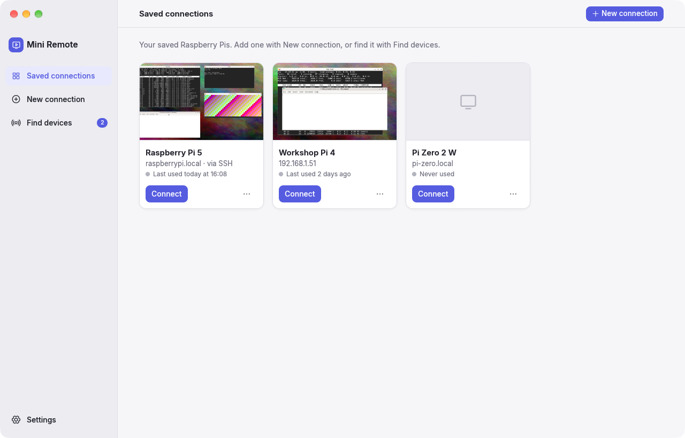
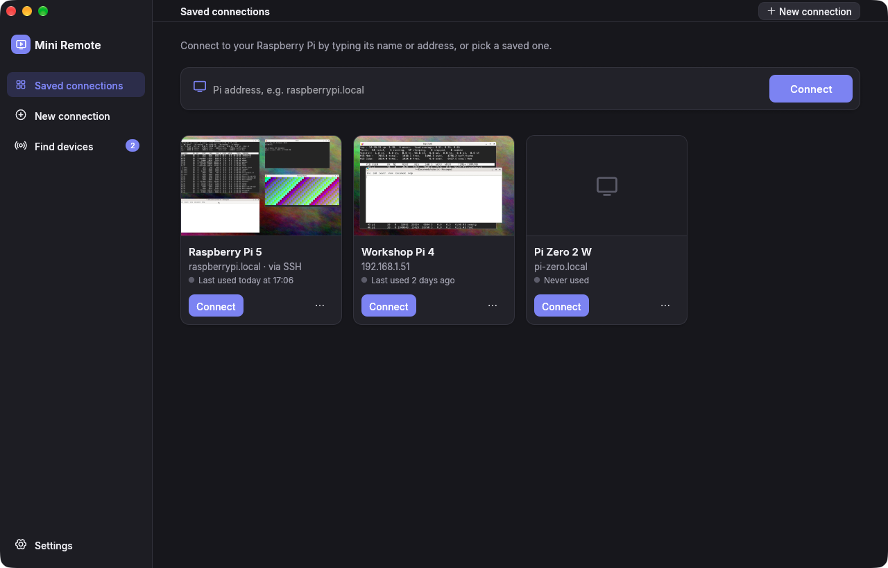
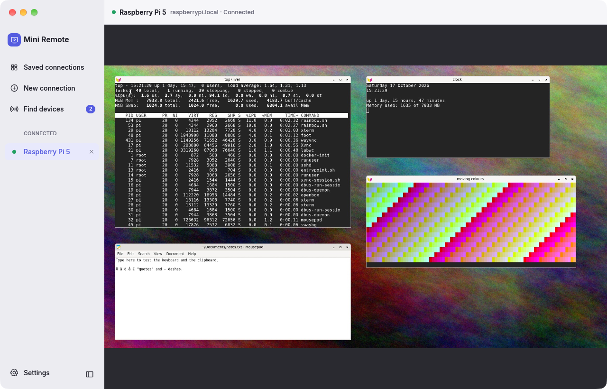
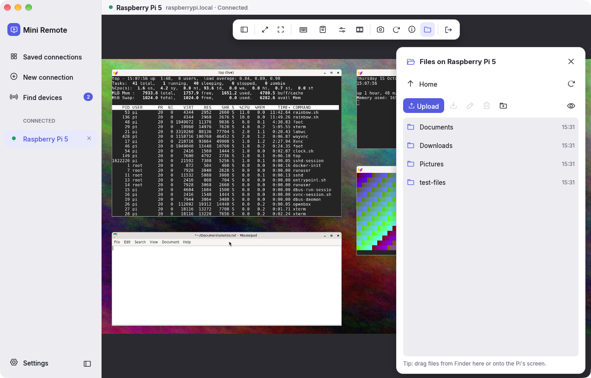
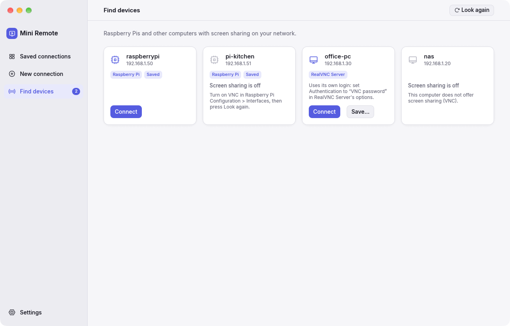
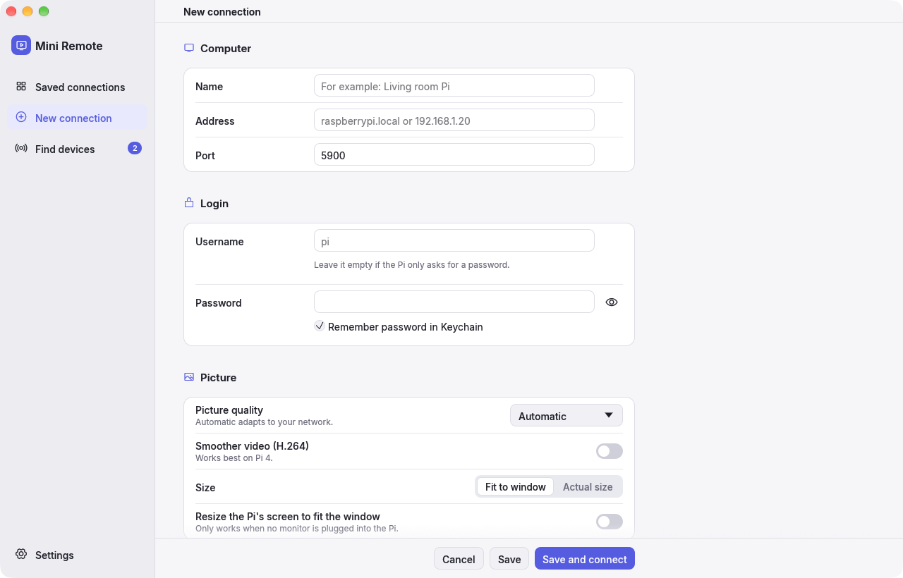
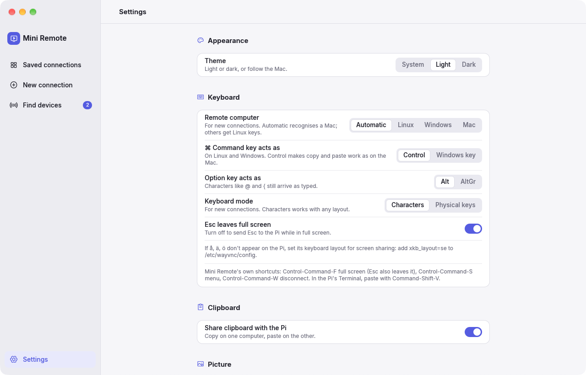

# Mini Remote

A free, simple app for your Mac that shows your Raspberry Pi's screen and lets you control it with your own mouse and keyboard.

<p>
  
  
</p>

## What it can do

- See and use your Pi's desktop from your Mac, in a window or full screen.
- Copy and paste text between your Mac and your Pi.
- Move files to and from your Pi.
- Find the Raspberry Pis on your home network for you.
- Connect safely from outside your home.
- Keep several Pis open at the same time.
- Remember your Pis and their passwords. Passwords are stored in the Mac's Keychain.
- Light and dark mode.

Mini Remote is free and open source (MIT licence).

## What you need

- A Mac with Apple Silicon (M1 or newer) and macOS 12 or newer, **or** a Linux computer: a normal 64-bit PC, or an ARM computer such as a Raspberry Pi with 64-bit Raspberry Pi OS. Ubuntu 22.04, Debian 12 and newer work. Windows isn't supported.
- A Raspberry Pi running Raspberry Pi OS with the desktop, from late 2023 or newer.
- Screen sharing turned on on the Pi (see below).

## 1. Turn on screen sharing on your Pi

On the Pi:

1. Open the Raspberry Pi menu, then **Preferences**, then **Raspberry Pi Configuration**.
2. Go to the **Interfaces** tab.
3. Turn on **VNC** (this is screen sharing).
4. Also turn on **SSH** if you want to move files or connect from outside your home.

No screen on your Pi? Run `sudo raspi-config` over SSH and choose **Interface Options**, then **VNC**.

## 2. Install Mini Remote

Download the newest version from the [Releases page](https://github.com/JohnKesko/mini-remote/releases/latest).

**On a Mac**

1. Download `Mini-Remote-…-macos-arm64.zip` and open it. You get **Mini Remote**.
2. Drag **Mini Remote** to your **Applications** folder.
3. The first time, your Mac says it can't check the app, because it isn't from the App Store. Open **System Settings**, then **Privacy & Security**, scroll down and click **Open Anyway**. You only do this once.
4. When your Mac asks if Mini Remote may find devices on your local network, click **Allow**. Mini Remote needs this to reach your Pi.

**On Linux**

1. Download the file for your computer: `…-linux-x86_64.tar.gz` for a normal PC, or `…-linux-arm64.tar.gz` for an ARM computer such as a Raspberry Pi.
2. Unpack it, open a terminal in the `mini-remote` folder and run `./install.sh`. Mini Remote then appears in your app menu.

Passwords are remembered in your system's password store (GNOME Keyring or KDE Wallet). Without one, Mini Remote still works but asks for the password each time.

### Updates

Mini Remote checks for a new version each time it starts. When there is one, it shows what's new and asks before doing anything. Choose **Update now** to download it, install it and restart, or **Later**, or **Skip this version**. You can also check in **Settings**, under **About**, or turn the check off there.

Every update is signed by the maintainer. Mini Remote only installs a download whose signature matches, so a changed or fake download is never installed.

### Build it yourself (Mac)

1. Install Rust from [rustup.rs](https://rustup.rs).
2. Download this project and open a terminal in its folder.
3. Run `scripts/macos/bundle.sh`. The app is now in `dist/Mini Remote.app`.

Running the command again replaces it with the new version (and reopens it if it was open). Your saved connections, settings and passwords are kept.

## 3. Connect to your Pi

1. Click **New connection** (top right, or in the sidebar) and type your Pi's name or address. Most Pis are called `raspberrypi.local`. Or open **Find devices** and pick your Pi from the list.
2. Log in with the same username and password you use on the Pi itself.
3. The first time, Mini Remote asks if this is really your Pi. Click **Yes, connect**. It remembers the answer and warns you if the Pi ever looks different.



Move the mouse to the top of the Pi's screen to show the toolbar. From there you can:

- fit the picture to the window, or show it at its real size
- go full screen
- send special keys like Ctrl+Alt+Del
- copy and paste
- change the picture quality
- take a screenshot
- see connection details
- open the Files panel
- disconnect

### Keyboard

- The **Command** key works like **Ctrl** on the Pi, so Cmd+C and Cmd+V copy and paste as you are used to.
- In the Pi's **Terminal**, paste with **Command + Shift + V** (terminals on the Pi paste with Ctrl+Shift+V).
- **Control + Command + F**: full screen on or off. **Esc** also leaves full screen (you can turn that off in Settings if you need Esc on the Pi).
- **Control + Command + S**: show or hide the sidebar.
- **Control + Command + W**: disconnect.

Mini Remote sets up the keys for the kind of computer you connect to. A Raspberry Pi (or any Linux or Windows computer) gets Command as Ctrl. If you connect to a Mac, Mini Remote notices it and keeps Command as Command, so copy and paste work there too. If it guesses wrong, choose **Remote computer** (Automatic, Linux, Windows or Mac) in the connection's settings. You can also change how the Command and Option keys behave in **Settings**.

## Move files

Click the folder button in the toolbar to open the Files panel. You can upload, download, rename, delete and make new folders. You can also drag files from Finder onto the panel or onto the Pi's screen. Downloads go to your Mac's **Downloads** folder.

The Files panel uses the Pi's secure remote login (SSH), so SSH must be turned on (see step 1).



## Find devices

**Find devices** looks for Raspberry Pis and other computers with screen sharing on your home network. Click **Connect** to open one, or **Save** to keep it in your list.



## Add or change a connection

Click **New connection** to save a Pi with a name, address and login. You can also choose:

- the picture quality
- smoother video (helps most on a Pi 4)
- whether the Pi's screen should resize to fit your window (only works when no monitor is plugged into the Pi)



## Connect from outside your home

Open the connection, then turn on **Connect through SSH** under **Secure remote login (SSH)**. Mini Remote then sends everything through the Pi's secure remote login, so the connection is encrypted all the way.

Your Pi must be reachable from the internet for this, for example through a VPN or a port forward for SSH on your router. Never open the screen sharing port (5900) directly to the internet.

## Settings

Choose light or dark mode, how the Mac's keys work on the Pi, clipboard sharing, picture quality, and more.



## If something doesn't work

**"Refused the connection"**
Screen sharing is off on the Pi. Turn on VNC (see step 1).

**Letters like å, ä, ö don't appear on the Pi**
The Pi's screen sharing uses its own keyboard layout. On the Pi, add a line with your layout to `/etc/wayvnc/config`, for example `xkb_layout=se` for Swedish, then restart the Pi.

**"This looks like RealVNC Server"**
Older Raspberry Pi OS uses RealVNC's screen sharing, which has its own private login. In RealVNC Server's options, set **Authentication** to **VNC password**. Then, in Mini Remote, turn on **Allow unencrypted login** for that Pi. Or update the Pi to a newer Raspberry Pi OS.

**Pasting doesn't work in the Pi's Terminal**
Terminals paste with Ctrl+Shift+V, so use **Command + Shift + V**. Elsewhere, Command + V works. You can also use **Type clipboard text** in the toolbar's clipboard menu.

**The Pi's screen won't resize to fit my window**
This only works when no monitor is plugged into the Pi.

**The connection drops**
Mini Remote reconnects by itself and shows a countdown while it tries again.

## For developers

Mini Remote is written in Rust with [egui](https://github.com/emilk/egui).

```bash
cargo build --release -p mini-remote
```

```bash
cargo test --workspace
```

The project is split into small parts:

| Folder | What it does |
| --- | --- |
| `crates/app` | The app (Mac and Linux): windows, pages, keyboard and mouse |
| `crates/rfb` | Talks to the Pi's screen sharing: login, picture updates, clipboard |
| `crates/codec` | Turns the Pi's picture data into pixels, including H.264 video |
| `crates/ssh` | Secure remote login: tunnel and file transfer |
| `crates/discovery` | Finds Pis on the local network |
| `crates/update` | Checks for, verifies and installs new versions, plus the release signing tool |
| `test-server` | A pretend Raspberry Pi in Docker, for testing without a real Pi |

Start the pretend Pi with `test-server/start.sh`. It runs the same screen sharing software as a real Pi (wayvnc), but only on your own Mac. The screenshots above were taken with it.

Build the Linux versions (x86_64 and arm64) in Docker with `scripts/linux/build.sh all`. The archives land in `dist/linux`.

### Making a release

1. Raise the version in `Cargo.toml` (for example `0.2.0`), commit and push.
2. Run `scripts/release.sh`. It builds the Mac and Linux versions, signs every file and publishes them as a GitHub release. Installed copies offer the update on their next start.

Releases are signed with a private key kept outside the project, in `~/.config/mini-remote/release-signing-key`. Make it once with `cargo run -p mini-remote-update --bin mini-remote-release -- keygen`, and put its public key in `crates/update/src/lib.rs`. **Keep a backup of the key and never share it.** Without it, installed copies can't be updated automatically any more.

## Licence

Mini Remote is free software under the [MIT licence](LICENSE).

It includes the [Inter](https://rsms.me/inter/) font (SIL Open Font License 1.1, see `assets/fonts/Inter-LICENSE.txt`) and Cisco's OpenH264 video decoder (BSD licence), built from source.

Raspberry Pi is a trademark of Raspberry Pi Ltd. VNC is a trademark of RealVNC Ltd. Mini Remote is not connected to either company.
